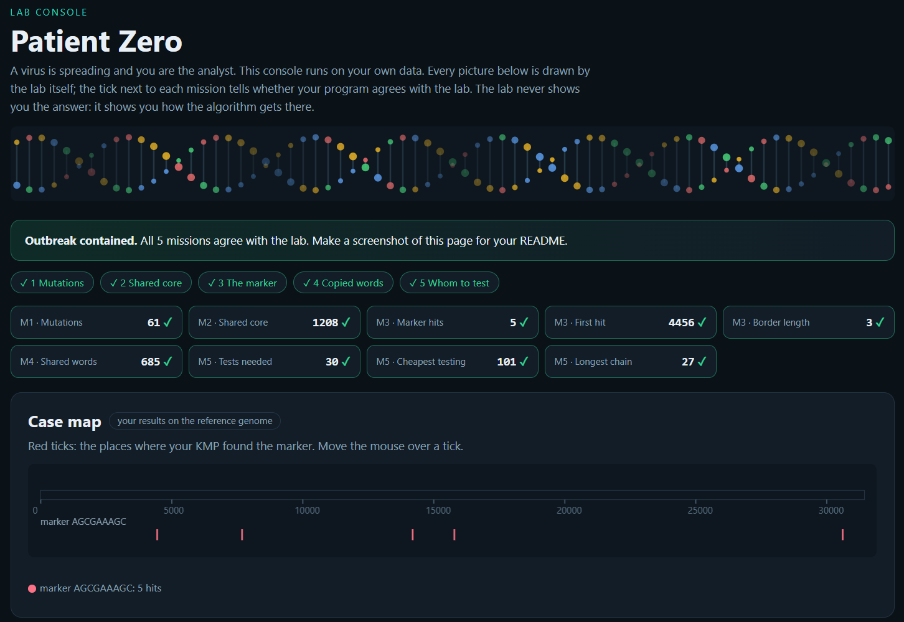

# Assignment 4. Patient Zero

Student ID: 252901
Name: Mariya Karle
Group: SE-2519

This file is the report. Fill it in as you go. How to start: `START_HERE.md`. The task: `docs/Assignment4.pdf`.

## Program output

The 9 lines your program prints on your data (`java -cp out Main`):
```
    Mutations: 61
    Shared core: 1208
    Marker hits: 5
    First hit: 4456
    Border length: 3
    Shared words: 685
    Tests needed: 30
    Cheapest testing: 101
    Longest chain: 27
```

My outbreak report (a screenshot of `output/outbreak.html`):



## Questions

Answer in your own words, two or three sentences each.

Mission 1. What does the cell d[i][j] of your table mean, and how is it computed from other cells?

I used dynamic programming to find the minimum edit distance by building up operations insert, delete, replace cell by cell. 
The base rows initialize pure additions and deletions, and each subsequent state picks the cheapest path forward.

Mission 2. How is the longest common subsequence different from the longest common substring? My Shared core is bigger than the number of letters that are the same at the same place: why?

LCS tracks non-consecutive matches by carrying the best neighbor values forward across mismatches, whereas longest common substring resets to zero on a mismatch.
Because LCS never throws away prior progress, its result is always at least as large as the longest substring.

Mission 3. What does the prefix function tell you, and why does the pointer in the text never go back in KMP? What is the Border length of my marker and what does it mean?

The prefix function precomputes the longest border so that mismatches
simply shift the pattern pointer without ever backtracking the text pointer, 
keeping the search strictly O(n + m). Looking up the final border value after 
a match also lets the algorithm cleanly detect overlapping occurrences.

Mission 4. Why must you compare the letters after the hashes are equal? What happens to the cost of Rabin-Karp if many windows have the same hash?
Rolling hashes let me slide across 12-letter windows in O(1) time,
but character-by-character checks are still required on matches to protect against hash collisions.
If collisions or identical substrings spike, those fallback string comparisons degrade runtime
toward O(n*k).
Mission 5. What are the two states of a person in your DP, and how do you get the answer for a person from its children? Why does a greedy "test the person with most links first" not always give the cheapest answer?
I solved the vertex cover using tree DP by balancing each node’s testing cost against the requirement
that unselected nodes must have all their children tested. A greedy approach fails here because picking
a high-degree node can cost far more than picking its neighbors (like a middle node costing 10 versus two 
leaves costing 1 each). To find the longest transmission chain, I combined the two deepest child branches
at each node and took the maximum across the entire tree.
## AI use

Gemini: explanation of the project, helped to fix my mistakes and explain what I did wrong.

## Timing (Mission 7)

Milliseconds, average of 3 runs, from `java -cp out Bench`.

| test          | size                     | time                       |
|---------------|--------------------------|----------------------------|
| naive search  | 20 000 / 40 000 / 80 000 | 57.0 ms / 95.2 / 2.9       |
| KMP           | 20 000 / 40 000 / 80 000 | 2.9 ms / 1.4 / 0.5         |
| edit distance | 500 / 1000 / 2000 / 4000 | 6.2 ms / 7.6 / 21.1 / 81.4 |

What do the numbers say about how the time grows? When you double the size, by how much does each time grow? Two or three sentences.
Edit distance shows quadratic growth (O(N^2)):
doubling the input from 1,000 to 2,000 and 4,000 roughly quadruples the time each step.
In contrast, the search benchmarks actually drop sharply as the size grows,
showing that the larger runs were skewed by JVM warm-up effects rather than reflecting 
true algorithmic scaling.
## Complexity

n is the length of the text (or of a strain), m the length of the pattern, k the length of the window, v the number of people. Fill in every algorithm you wrote.

| algorithm                 | time        | space  | assumptions                                                    |
|---------------------------|-------------|--------|----------------------------------------------------------------|
| Edit distance             | O(n*m)      | O(n*m) | Every edit (insert, delete, change) costs 1.                   |
| LCS                       | O(n*m)      | O(n*m) | Letters either match or they don't; order matters.             |
| Prefix function and KMP   | O(m)/O(n+m) | O(m)   | Comparing two letters takes one step; pattern does not change. |
| Rabin-Karp (shared words) | O(n+m)      | O(m)   | Hash collisions are rare; fixed window size k.                 |
| Tree DP                   | O(n)        | O(n)   | The network is a tree with non-negative costs.                 |

## Before you submit

- The four files in `data` and the screenshot `output/outbreak.png` are in the repository.
- `java tools/Check.java` shows all examples right.
- This README is filled in, the program output and the section AI use included.
- The work is pushed to main (at least one commit per mission) and the repository is public.
- The link is attached in Moodle.
